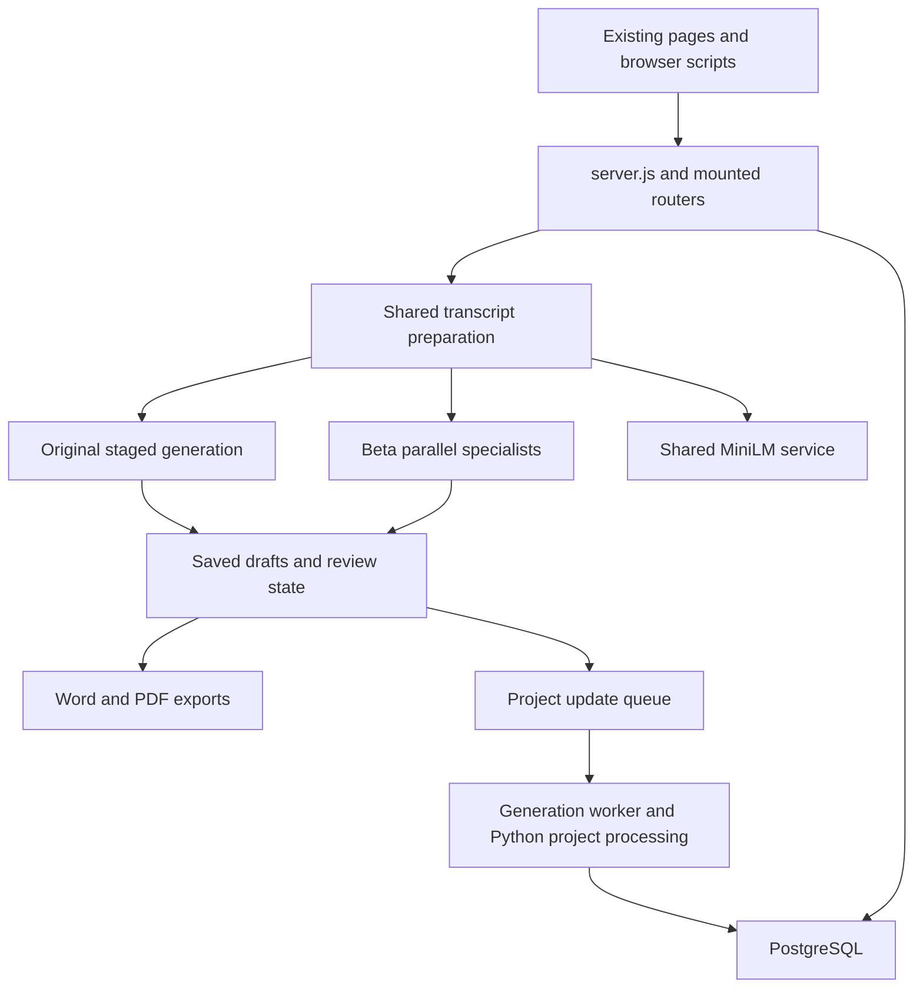

# Live product map and first cleanup boundaries

Inspected 30 October 2026 at deployed revision
`ea18d4ae5e0bb3dedb9ae9596f35fb89b60a1657` (PR #202).
This map records the inspected baseline and the subsequent boundary cleanup.
The current frontend, route contracts and saved-data formats remain unchanged.

## What runs

The product has one Express web process, two PM2 workers, and a shared MiniLM
system service. The main minutes editor runs both Original and Beta. Project
updates can start from the reviewed minutes produced by either engine.

The diagram shows the main handoff; the sections below include the additional
mounted pages, older processing paths and operational entry points.

| Entry point | Implementation | Observed status / responsibility |
| --- | --- | --- |
| Web | [`server.js`](../server.js), PM2 `trinzo`, cwd `/srv/m365-agent-test` | Online; serves pages, API, in-process minutes generation and polling. Default port 3978. |
| Generation queue | [`scripts/meeting_minutes_final_worker.js`](../scripts/meeting_minutes_final_worker.js), PM2 `trinzo-minutes-final-worker` | Online; claims meeting-minutes and project-update jobs from PostgreSQL. |
| Local rewriter | [`scripts/minutes_local_rewriter_worker.py`](../scripts/minutes_local_rewriter_worker.py), launched through bash by PM2 `trinzo-minutes-rewriter` | Online; imports `LocalMinutesRewriter` from `meeting_minutes_minilm_experiment.py`. No repo caller is needed for this external entry point. |
| Shared embeddings | `global-minilm.service`, deployed under `/srv/global-minilm` | Active; repo compatibility source is [`ops/global-minilm/global_minilm_worker.py`](../ops/global-minilm/global_minilm_worker.py). Used through loopback port 8767. Separate service deployment. |
| Knowledge embedding | [`utils/knowledge.js`](../utils/knowledge.js) → Python embedding/retrieval scripts | Spawned on demand; optional web-process interval. No separate Trinzo PM2 knowledge process was observed. |

The web configuration selects `legacy` by default, with hybrid V4 and speculative
processing enabled. Beta remains a per-upload choice for administrators and is
persisted as `generationProvider: parallel-specialists-v1`. Environment settings
can differ between processes: the web's Beta short-answer retention switch was
enabled while the two PM2 workers' switch was disabled. Do not infer one process's
configuration from another's. No provider calls were made during this audit.

## Pages and their owners

All local `/static/*` assets come from `public/`, except the timing helper served
directly from `utils/meetingMinutesTiming.js`. `server.js` owns page mounting and
redirects. “Mounted” proves availability in code; it does not prove recent use.

| Surface | Routes | Browser/source and backend owners |
| --- | --- | --- |
| Main minutes editor | `/` redirects to `/meeting-minutes-agent` | `views/meeting-minutes-agent.html`; `public/meeting-minutes-agent.js`, filing-order/project-link helpers; `/api/meeting-minutes-agent/*` in `routes/api.js`. |
| Library and saved jobs | `/jobs`, `/jobs/:jobId`, `/jobs/:jobId/result`; `/meeting-minutes-final/jobs*` aliases | `views/meeting-minutes-jobs.html` (inline browser code); draft/job endpoints in `routes/api.js`. Includes current drafts and queued-job compatibility. |
| Project workspace | `/project-update-test` with Setup, Process, Reports, Insights, Memory, Settings and Tasks stages | `views/project-update-workspace.html`; `public/project-workspace.js`, `project-stage-*.js`, `project-update-shared.js`; generation/context endpoints in `routes/api.js`, record CRUD in `routes/projectRecords.js`, tasks in `routes/internalAiTasks.js`. |
| Project deep links | `/project-update-test/reports/:reportId`, `/milestones/:milestoneId`, `/context/snapshots/:snapshotId` under the project prefix; `/project-update-test/roadmap`, `/roadmap` | Report, milestone, context and roadmap views. Old list routes redirect into workspace stages; retain their URLs. |
| Settings and insights | `/settings`, `/insights` | Settings/insights views and public scripts; `routes/settings.js`, `utils/settingsDb.js`, `utils/settingsStore.js`; minutes insights endpoint in `routes/api.js`. |
| Older mounted minutes surfaces | `/meeting-minutes-final`, `/staged-meeting-minutes`, its `/client-output`, `/pre-testing`, `/analytics`, plus `/staged-meeting-minutes-analytics` | Existing views, inline scripts and `public/test-transcript-page.js`; staged/final endpoints in `routes/api.js`. Their names do not establish that they are unused. |
| Feedback | `/meeting-minutes-feedback*`, `/review-feedback` | Feedback views; final feedback submission in `routes/api.js`, review CRUD in `routes/minutesFeedback.js`; `routes/reviewFeedback.js`. Review snippet is injected by the standard page renderer. |
| Microsoft integration | `/meeting-agent`, `/meeting-agent/auth-redirect` | `client/meeting-agent*.js` bundled into `public/meeting-agent*.js`; `routes/meetingAgent.js` handles Microsoft identity, Copilot, uploads, transcript subscriptions and notifications. Separate from the main minutes editor. |
| Login and entry pages | `/dashboard`, `/auth`, `/auth/login`, `/login`, `/auth/forgot-password` | Dashboard/auth views and `routes/auth.js`. `/auth/register` and `/register-success` redirect to login; API self-registration is disabled. |

The Microsoft integration has a file-backed transcript subscription/event store
(default `/var/lib/m365-agent-test/transcript-subscriptions.json`). PostgreSQL is
not its only persistence boundary. Its webhook and callback routes must survive
route reorganisation, even if they have little browser traffic.

## Processing and persistence boundaries

1. **Shared upload/preparation.** `POST /api/meeting-minutes-agent/prepare` reads the
   upload, applies configured phrase corrections and calls
   [`utils/stagedMiniLmTrooper.js`](../utils/stagedMiniLmTrooper.js) →
   `scripts/staged_simplified_minilm.py`. That Python script imports the usefulness
   classifier and can use the shared embedding worker. The JS default classifier
   is `artifacts/meeting-minutes-usefulness-v3/classifier.joblib`; environment can
   select a different path. Both engines use this preparation boundary.
2. **Original.** [`utils/meetingMinutesProcessing.js`](../utils/meetingMinutesProcessing.js)
   owns initial engine dispatch with separate `startOriginal` and `startBeta`
   entry points. `runMeetingAgentBackgroundStage` and
   `generateHybridMeetingAgentStage` in [`routes/api.js`](../routes/api.js)
   coordinate background jobs and publication.
   `utils/meetingMinutesOriginalStages.js` composes the Original Summary,
   Discussion and Actions services. Separate execution, discovery, finalization
   and fallback/edit modules own provider calls, caches, timing and review.
   The first background stage is discussion;
   actions and summary have their own stage handling and speculation.
   `utils/meetingMinutesAgentV2.js`, `utils/canonicalMinutes/*` and staged helpers
   remain live dependencies. The main editor's background work runs in the web
   process, independently of the browser connection.
3. **Beta.** [`utils/meetingMinutesParallel.js`](../utils/meetingMinutesParallel.js)
   owns provider selection, draft projection, review changes and runner state;
   [`utils/meetingMinutesParallelEngine.js`](../utils/meetingMinutesParallelEngine.js)
   runs summary, discussion and actions concurrently. Prompt files live in
   `config/meeting-minutes-parallel/`. An external configuration file supplies
   published endpoints and instruction hashes; repo files alone do not recreate
   the provider deployment. Beta background work also runs in the web process.
4. **Saved drafts and review.** `utils/db.js` reads/writes drafts; `routes/api.js`
   handles ownership, optimistic revisions, edits, undo/redo, generation status
   and project links. `utils/meetingMinutesDraftStorage.js` owns stored-payload
   versioning and migration; the database no longer imports V2 for that operation.
   `utils/meetingMinutesProposals.js` owns proposal diffing and acceptance, using
   the shared record-matching and action-identity helpers. V2 retains compatibility
   re-exports. Wire schema version 4 remains separate from stored payload version 5.
5. **Exports.** The two authenticated `.../drafts/:draftId/export.docx` and
   `export.pdf` routes build publication projections. Word uses
   `utils/meetingMinutesAgentDocx.js` and JSZip; PDF uses
   `utils/stagedMinutesPdf.js`, Playwright Chromium and installed Roboto assets.
   Both engines export through these boundaries. Word no longer directly imports
   V2 following the earlier shared-helper extraction.
6. **Project handoff.** `POST /api/project-update-test/from-minutes` checks the
   saved revision, builds reviewed minutes text and carries reviewed actions
   separately via `utils/minutesForProjectUpdate.js`, then queues a job. The PM2
   generation worker runs `utils/projectUpdateGenerator.js` →
   `scripts/project_update_minilm.py`, with `python_llm.py` fallback and knowledge
   retrieval. The project's Beta switch chooses the minutes engine; it does not
   replace project-report generation. Direct/older project processing endpoints
   remain mounted too.
7. **Older queue/staged paths.** The same worker runs
   `utils/meetingMinutesGenerator.js` → `scripts/meeting_minutes_trooper.py` for
   minutes jobs. The staged endpoints also call Python/canonical processing from
   the web process. Preserve existing job types, polling aliases and result
   payloads until their callers and historical saved jobs are accounted for.
8. **Cross-cutting storage.** `utils/db.js` owns much of PostgreSQL access;
   `sql/` contains migrations. Settings persist people/glossary in PostgreSQL and
   publish a temporary Python snapshot through `utils/settingsStore.js`.
   `utils/knowledge.js` spawns embedding/retrieval scripts; project history,
   milestone binding and scoped internal tasks have additional helpers. CLI
   imports and backfills are operational tools, even when no page imports them.

## Product, evaluation and operations

| Classification | Examples | Cleanup rule |
| --- | --- | --- |
| Runtime code/data | Mounted views, routes, helpers, Python processors, classifier binaries, settings defaults, prompt configuration | Preserve until equivalent behaviour and every entry point are demonstrated. |
| Evaluation consumed by a mounted screen | `scripts/meeting-minutes-core-golden/{cases,human_benchmarks,run_record.csv,runs/}`, `artifacts/pre_testing_latest.json` | `utils/meetingMinutesCoreGolden.js` reads manifests, run records and recorded output paths for `/api/staged-meeting-minutes/pre-testing`. Archive only after tracing individual consumers and retaining displayed results. |
| Standalone evaluation / research candidates | Sweeps, paired replays, feasibility scripts, comparison reports | A lack of imports means candidate status. They may call paid providers, write caches/reports, or be run manually. Inspect inputs, outputs and external invocation before archiving; do not execute them to discover their purpose. |
| Operations | `deploy.sh`, SQL migration/backfill scripts, `meeting_minutes_topic_arranger_backfill.js`, `warm_minilm_cache.js`, Python shell wrappers | Preserve or document a replacement. The topic-arranger backfill can update saved drafts; it is not disposable research. |
| Build outputs | `public/meeting-agent.js`, `public/meeting-agent-auth-redirect.js` | Generated from `client/` by `scripts/build_meeting_agent.js`; do not edit generated bundles independently or mistake the source/output pair for duplicate features. |
| Documentation used as input | `docs/CURRENT_PROJECT_STATUS.md` | Input to the explicit task-import workflow and its tests, with frozen proposal references. It is not merely an obsolete prose page, nor an automatically read runtime configuration file. |

## Boundary cleanup progress

1. **Completed: two unserved templates removed.** `views/auth-register.html` and
   `views/register-success.html` have no page handler and no filename references
   elsewhere in the tracked baseline. Their former URLs redirect to login, and
   API registration explicitly returns 404. Remove only the templates; preserve
   those redirects and the disabled-registration response. Check references and
   the affected login/redirect behaviour. This is a small, high-confidence batch,
   not the main source of code reduction.
2. **Completed: stored-draft migration extracted.** Move `PAYLOAD_VERSION`,
   `STEP_V2_TO_V3` and `migrateDraftPayload` into a small dependency-free draft
   storage module. Have `utils/db.js` import it directly and keep V2's existing
   exports as compatibility re-exports. Leave the provider response schema and
   timing-policy constants unchanged. Preserve old step remapping, supporting
   detail defaults, current-version identity and idempotence. Existing migration
   cases are in `tests/meeting-minutes-agent-v2.test.js`; persistence and affected
   database fixtures must also pass. This removes the storage → entire generator
   dependency without changing what is stored or rendered.
3. **Completed: proposal handling extracted.** V2's `buildProposal`, `applyProposal` and
   their local diff/matching helpers form a bounded group near lines 7477–7701.
   Dependencies include text cleanup, stable IDs/token matching and
   `meetingMinutesActionIdentity.js`. Preserve proposal IDs, duplicate occurrence
   handling, partial acceptance and stale-edit protection. Keep compatibility
   exports while moving actual consumers to the new module; otherwise file
   movement alone will not narrow test coupling.
4. **Started: API route separation.** Project-record CRUD and final-feedback
   review now live in separate registration modules. Their paths, middleware
   ordering and handler bodies are unchanged. Shared sanitised error responses
   live in `utils/apiErrors.js`. Continue splitting API routes after establishing
   service boundaries. Start with a
   bounded family such as project CRUD or final-feedback CRUD. Preserve mount
   paths, middleware order, authentication and response/error shapes. Move shared
   operations into services before moving dependent handlers; do not have a new
   router import the old API router. Its `stagedEvaluation` export is also used by
   scripts and tests and needs a compatibility path during extraction.

The research-only archive from PR #201 remains separately recoverable through
`research-archive.json`. This cleanup deletes only the two unserved templates;
uncertain-use scripts and UI-consumed evaluation data remain available.

The completed generation/ownership boundary chunk separates state/timing/telemetry into
`utils/meetingMinutesAgentGeneration.js` and review diff/interaction analytics
into `utils/stagedReviewAnalytics.js`. Two small API wrappers retain the current
process boot ID, current hybrid flag and stage map. Plain text coercion is shared
in `utils/meetingMinutesPlainText.js`; it intentionally does not apply the domain
terminology corrections in `meetingMinutesText.js`.

People, assignment, ownership, attribution and conflicting-role evidence now
live in `utils/meetingMinutesPeopleEvidence.js`. V2 composes that module once
with its existing transcript context, flag registry and action-disposition
policy. Those shared services retain their cache/identity behaviour; the new
module does not import the V2 generator. Compatibility exports remain in place.

This chunk reduces `routes/api.js` from 21,113 to 20,720 lines and V2 from 7,591
to 6,976 lines. Sixteen existing generation/timing/people cases move with their
owners; existing review-analytics tests use the new module directly. Focused
checks are included in the compact core, and database-sensitive release selection
recognises the new generation and people-evidence boundaries.

The compact core also includes the existing timing-closure cases: ownership
evidence and final timing must continue sharing the same work-word rules.

The completed stage-result boundary separates merge and conflict policy into
`utils/meetingMinutesStagePersistence.js`. The actual background save path calls
that service; queueing, optimistic retries and authenticated writes remain in the
API. Shared pass-cache normalisation, Discussion fingerprints and source-unit
normalisation have direct helper owners, with the old compatibility exports
retained.

Saved consolidation proof and paired-action recovery live in
`utils/canonicalMinutes/discussionClaimConsolidationState.js` and
`discussionActionRecovery.js`. Assessment modules re-export the existing public
functions. The persistence service can therefore check stored evidence and
recover original content without importing model assessment, the API or V2.

Six existing merge/conflict cases move to direct service tests, covering all
three stage completion orders, unrelated reviewer edits, concurrent Discussion
edits and absent/empty supporting-detail pools. Route writes, background retries,
paired-proof publication and changed-source/date guards retain their existing
integration consumers. This is a dependency boundary; it does not remove the
remaining API test coupling or reduce the total regression case inventory.
For this batch, a proposed policy edit selected 300 JavaScript files while its
implementation lived in the API; the extracted service selects 174, including
the compact core. The API itself now selects 301 because the core includes one
additional file containing moved cases. The six direct policy cases run without
loading the API or V2. The API shrinks from 20,720 to 20,588 lines; V2 from 6,976
to 6,964. These are structural and dependency measures, not deleted-code totals.

The completed Original orchestration extraction separates Summary, Discussion
and Actions into `utils/meetingMinutesOriginal{Summary,Discussion,Actions}.js`.
`meetingMinutesOriginalStages.js` composes them with shared execution and discovery;
`meetingMinutesOriginalFinalization.js` owns semantic/publication finishing and
`meetingMinutesOriginalEdits.js` owns the existing fallback and explicit AI edits.
Summary timing verification shares its owner with Summary; review packet errors
share the existing review-accounting owner. The API retains its diagnostic and
Beta guards, background jobs and authenticated operations. All previous
`stagedEvaluation` exports remain; an additive service-composition hook lets
Discussion/Actions/edit tests use the actual API policies while stubbing I/O.

One mutable execution context preserves the live pass cache, referee failure
audit and stage deadline across concurrent provider completions. Stage arrays
retain their original identities. Module-owned helpers are imported from their
actual owners; API-owned callbacks remain explicit. This reduces `routes/api.js`
from 20,588 to 18,135 lines, without changing prompts, frontend assets, route
handlers, schemas, configuration or engine defaults. The new direct checks cover
cache concurrency, temporal verification, referee/fidelity fallback, independent
provider legs and reviewer text protection. Three existing Summary cases move
with their owner; all prior regression behaviour remains covered.

This is a structural simplification, not equivalent deletion of product code.
Genuine V2 policy dependencies and many API-owned callbacks remain. Summary's
direct tests avoid the API; Discussion, Actions, execution and edit tests still
load the API composition to obtain real policy callbacks. Further useful batches
are bounded route families and those shared policy owners, followed by narrowing
their test dependencies. A smaller test selection is only justified after those
dependencies actually disappear. A hypothetical edit to one extracted stage
currently selects 179 JavaScript files including the compact core, compared
with 301 for the API before extraction. Editing the remaining API selects 306;
the five added focused files account for that increase. These are file-selection
counts, not assertions about runtime test cases or eliminated coverage.

The next route boundaries separate project context (five handlers) and knowledge
(seven handlers) into `routes/projectContext.js` and `projectKnowledge.js`, using
real database and knowledge service owners. Recursive request-flag parsing now
has one shared owner in `utils/requestFlags.js`. The knowledge handlers had eleven
calls to an unbound `sendJson`; the existing response utility now supplies that
binding, restoring the intended JSON validation/not-found/error responses. No
successful response or provider limit changes.

Generic job management lives in `routes/generationJobs.js`; historical meeting-job
management lives in `routes/meetingMinutesJobs.js`. Its list and command registrars
stay at their original router positions. Job submission, generation runners,
background caches and source-job resume handling remain with their existing
owners. Staged retries use the same explicit launch callback.

`utils/meetingMinutesJobEdits.js` owns historical job-result editing. It preserves
unknown payload fields, the first original-output snapshot, metadata fallbacks,
row limits, grouped/flat result formats, reviewer identity and the single edit
timestamp. The route retains authentication, completion checks, validation and
persistence. Existing frontend-source contracts follow these real owners while
still asserting API registration. Direct route tests import neither the API nor
V2; the existing mounted authentication check covers every moved endpoint.

These two completed plan stages move 24 handlers and reduce `routes/api.js` from
18,135 to 17,707 lines. All 94 effective registrations keep their order and
middleware. This is structural cleanup, with one narrow missing-response-helper
fix; it does not delete features or reduce the historical regression inventory.
A hypothetical edit to a new route owner selects 183–184 JavaScript files,
compared with 306 for its former API owner. The remaining API selects 310;
the four added compact-core files account for that increase. Shared API/V2
policy coupling is unchanged by this route-only batch.
The remaining plan is shared API/V2 policy ownership, publication/Library/exports,
reviewer save/history, generation lifecycle and verified redundancy removal.

The first shared-policy batch adds `utils/meetingMinutesDraftContext.js` as the
owner of detail sanitisation, confirmed timing anchors and prompt date context.
V2 retains the exact sanitizer reference as a compatibility export. Settings
People classification and the existing calendar/context rules keep their real
shared settings and timing dependencies; no directory or cache is copied.

Response errors, referee route/accounting checks and action materialisation
validation now live in `utils/meetingMinutesResponseContracts.js`. Structural
Discussion rows have their own shared owner, and referee batching/concurrency
lives in `utils/meetingMinutesRefereeBatches.js`. Prompt fingerprinting and the
replay-cache flag join the existing pass-cache owner. All 17 moved functions
retain their original bodies. Empty-discovery validation and result aggregation
stay with their current API policies until those real dependencies move.

The Original modules import these policies directly. Their shared API callback
map shrinks from 140 to 126; Original execution needs only provider-retry and
private-prewarm I/O ports, down from eight mixed policy/I/O callbacks. Its four
existing tests now forbid loading the API or V2. Three attendee/settings files
also test their actual shared owner without importing generation; Teams parsing
integration cases keep the real API in a separate file.

Seventeen existing cases move with their owners, with no cases added or removed.
The compact core includes the moved cases while retaining its prior behaviours.
API lines fall from 17,707 to 17,419; V2 from 6,964 to 6,909. All previous API/V2
compatibility exports and 94 effective route registrations remain.

These are genuine ownership boundaries, with limits: remaining stage/grounding
policies still depend on API/V2, and settings refresh retains its lazy database
path. API consumers decrease from 295 to 292 and V2 consumers from 250 to 247;
total selected files rise from 310 to 311 and 266 to 267 as the compact core gains
three owner files. A response/batching owner edit selects 185 JavaScript files;
the genuinely shared DraftContext owner selects 269. No overall regression-count
or total-selection reduction is claimed. Next within shared policy ownership are
evidence/grounding and reviewer-flag foundations, including their shared caches
and registry, before publication and the remaining route/lifecycle stages.

The next shared-policy batch gives review warnings one real owner in
`utils/meetingMinutesReviewFlags.js`. Thirteen existing functions and their
constants move unchanged, covering typed warning context, normalisation,
usefulness, reconciliation and identity/deduplication. The private registry keeps
the same 20,000-entry limit, refresh ordering and oldest-entry eviction. V2's five
public flag APIs remain the same function references as the shared owner.
Resetting the evidence-context cache still leaves reviewed warnings intact.

The API, Original Actions/Discussion/Discovery/Edits and temporal review import
their flag operations directly. People evidence also uses that owner directly;
its factory now receives only transcript context and action disposition, removing
the obsolete flag callback. All nested people and Original stage bodies remain
unchanged. The temporal-review call uses the identical shared function. The API
stage callback map remains 126; no replacement callback bag is introduced.

Two existing pure cases move to `tests/meeting-minutes-review-flags.test.js`.
That file and the existing coverage-evidence tests have no API/V2 dependency,
including transitive imports. The canonical coverage case remains with its real
integration tests. The existing deterministic-warning test additionally verifies
cross-consumer recovery, shared function references and the context-only cache
reset. PATCH/save/reload/undo and citation-order integrations remain in place.
No global regression cases are added or removed. The compact core includes the
direct owner and coverage-evidence files.

V2 falls from 6,909 to 6,699 lines. API wiring grows from 17,419 to 17,421 lines;
its 94 effective registrations and all compatibility exports remain unchanged.
Raw API/V2 consumers each decrease by one, but compact coverage adds files:
API selection rises from 311 to 312 and V2 from 267 to 268. A shared review-flag
edit legitimately selects 268 JavaScript files and persistence coverage. These
are ownership improvements; no total test-selection reduction is claimed.
Evidence/grounding and its shared caches are the next stage-3 boundary, followed
by publication/Library/exports, reviewer history and generation lifecycle work.

The shared evidence-context batch moves 16 existing context/scoring and
transcript/window functions into `utils/meetingMinutesEvidenceContext.js`.
Their function bodies, source filtering, numeric/spoken-value matching and score
weights remain unchanged. The module owns one WeakMap keyed by source-array
identity, including each context's existing resolution-cache object. Reset still
replaces only that WeakMap, preserves contexts held by in-flight callers and
leaves the shared review-flag registry intact. V2 keeps its compatibility
references and unchanged resolver implementation, including its cache key,
copy-on-return and clearing rules.

The API imports transcript projection, scoring and cache reset directly from
their shared owner. People evidence imports context directly too; its factory
now receives only the remaining action-disposition policy. The flag-only
`mergeMeetingAgentFlags` implementation moves to the existing review-flag owner,
with equivalent local binding names. Original Actions and Edits import it
directly, reducing their API callback map from 126 to 125. Its ordering, useful
flag filter, review-status/note precedence, registry effects and first-250 limit
remain unchanged. No new API compatibility export is introduced.

The two existing spoken-number cases now test the real context owner without
loading API/V2, including transitive imports, and join the compact core. Existing
cache/reset tests also verify shared function references, distinct array keys,
reset from either entrypoint, old-context survival and warning preservation.
Reviewer PATCH tests use the actual flag merge helper. Generation, resolver,
save/reload and undo integrations remain. No global cases are added, removed or
moved between files; the existing Python source check follows the retained
public-draft boundary.

API falls from 17,421 to 17,407 lines and V2 from 6,699 to 6,534. All 94 effective
route registrations and previous API/V2 exports remain. API/V2 raw consumers
each decrease by one; total selections stay at 312 and 268 files as the compact
core gains the existing numeric-evidence cases. The shared context owner also
selects 268 files and persistence coverage. The actual text/settings dependency
retains its lazy database path. This is another shared-policy boundary; resolver,
action-disposition and bounded-review evidence policy remain to be separated
before the publication and remaining lifecycle stages.

The next grounding batch gives action evidence and source resolution real
owners. `utils/meetingMinutesActionEvidence.js` owns ten existing predicates and
19 constants, including the predicate/lexicon formerly inside the people factory.
`utils/meetingMinutesEvidenceResolution.js` owns the unchanged resolver. These
modules use the existing text, context, timing and diagnostics owners, with no
API/V2/People imports or supplied policy callbacks. They do not copy the source
WeakMap, resolution cache, flag registry or diagnostics context.

People evidence now exports its helpers directly. The final action-disposition
callback and factory are removed; all three known callers use actual owners.
Its 22 retained function bodies change only through uniform dedenting. The
reviewed production composition previously constructed one instance, and known
callers do not mutate exported policy constants. V2 keeps its existing public
function references and compatibility exports while composing the direct owners.

The API and Original stages import their owned action, people and resolution
operations directly. Timed-step coverage removes its sole V2 import and uses
the action-evidence owner. All retained route and processing bodies remain
unchanged. Existing cache/registry tests additionally check actual resolver
diagnostics, cross-entrypoint cache hits and resets. Four existing pure action
cases move unchanged to the direct-owner file and join the compact core. People
and owner-evidence tests no longer load V2, even transitively; mixed generation,
timing, save/reload and undo integrations remain. No global cases are added or
removed.

The existing task browser integration now waits for its own successful save
response and completed refresh before proceeding. The previous `Saved.`-only
wait could accept an earlier operation while the save handler was still busy.
All persistence assertions and existing cases remain; application code and UI
are unchanged. The first release attempt's failed mobile check is retained in
the private verification record, followed by the corrected required release run.

V2 falls from 6,534 to 6,220 lines, People from 683 to 611, and API from 17,407 to
17,402. All 94 effective routes, 223 API exports and 158 V2 exports remain; the
Original API service map stays at 125. Raw API/V2 consumers each decrease by two,
but total selections remain 312 and 268 as compact coverage expands. Action
evidence selects 269 JavaScript files and resolution 268, with persistence
coverage. The full static text/settings graph retains its lazy database path.
Bounded-review evidence packets and remaining substantive API policies still
need explicit ownership before the later publication and lifecycle stages; this
batch does not mark stage 3 or the whole simplification plan complete.

### Bounded review evidence and response accounting

Review-packet selection now belongs to `meetingMinutesReviewEvidence`, with the
existing speaker identity matcher in People and the unchanged common speech-word
Set in RecordMatching. The two function bodies and Set declaration move intact.
V2 retains its public packet export as the same function. Selection caps, anchor
priority, original ordering, character overflow and coverage metadata remain;
selection does not certify facts, ownership or timing. The existing context and
cache/reset identities remain shared. Different purpose-specific stoplists stay
separate.

The existing ResponseContracts owner also takes six deterministic disposition,
repair, accounting and materialization helpers, with their two enum constants.
They import the actual text, source, discussion-row and review-flag owners and
crypto. Original Discovery, Discussion and Actions import those functions
straight from ResponseContracts, removing six supplied service entries (125 to
119) without changing their processing bodies. The API compatibility exports,
all route registrations, provider prompts and public assets remain unchanged.
No new callback factory, policy port, state registry or cache is introduced.

Six existing cases move into compact owner checks: one packet-selection case
and five response/accounting cases. Candidate-disposition checks also import
their actual owner. Every original case and assertion remains, including the
mixed generation, materialization and provenance integrations. There is no
reduction in the overall regression bank; the infrastructure mapping updates
require its full release profile, including disposable-database coverage.

That batch established packet and deterministic contract ownership. The next
batch below owns the actual duplicate and aggregation policies that were still
needed by source-backed discovery validation.

### Action duplicates and result aggregation

The actual cross-pass action/proposal duplicate policy now has a dedicated
`meetingMinutesActionDuplicatePolicy` owner. Thirty-three existing functions
and thirteen constants move without changing their declarations: three generic
text/overlap helpers belong to the existing RecordMatching owner, while the
thirty action-specific functions and constants remain together. Existing
canonical duplicate, deliverable, timing and reviewer policies remain actual
imports. This policy stays distinct from V2 normalization's own coverage merge;
shared vocabulary does not make their decisions interchangeable.

Source-aware timing and ownership, distinct work steps and recipients,
conditional delivery, document workflows, reviewer-authored rows, provenance,
flags, diagnostics and stable ordering keep their existing behaviour. Exported
Sets/regexes have no tracked mutation writers; derived stoplists remain fresh
Sets. There is one actual diagnostics module and one shared evidence context
and reset path, with no new factory or callback bag.

Three result-aggregation functions now import this duplicate policy, PlainText,
ReviewFlags and the shared schema owner. ResponseContracts owns the unchanged
`SCHEMA_VERSION = 4`; V2 retains the same public compatibility export, and API,
Original Discovery and aggregation import the same constant. Provider prompt
functions and resulting schema version remain unchanged. The union retains
missing-leg identity and first-leg field authority. Repair and batch mergers
retain their existing overwrite, count and ordering rules and shared warning
identity.

Original Discovery and Actions import the six moved policy functions directly,
reducing supplied service entries from 119 to 113. Their processing bodies stay
unchanged. API falls from 17,208 to 16,221 lines and V2 from 6,157 to 6,153; all
94 effective routes, 223 API exports and 158 V2 exports remain. Fifteen existing
cases move into compact owner checks, with no added or removed regression cases
or assertions. Mixed generation, repair-prompt, feature-switch, publication and
persistence integrations remain. New owners retain persistence-sensitive test
selection; updating compact coverage selects the full required release profile.

Those actual duplicate and aggregation owners make the following full
normalization and source-backed discovery-validation batch possible. The moves
reduce the large entrypoints and supplied policy dependencies; they do not
claim fewer lines/cases across the whole repository or regression bank.

### Result normalization and source-backed discovery validation

The complete result-normalization dependency set now has actual owners: 96
existing declarations (71 functions and 25 constants), including the adjacent
document-reference evidence helper. Discussion, actions, source matching,
field grounding, timing inference, evidence checks and assessment evidence have
cohesive modules; Text, PeopleEvidence and ReviewerEdits receive their existing
wording, identity and reviewer-metadata helpers. ResultNormalization coordinates
these actual policies. All moved declarations remain byte-exact. This is the
real normalizer, retaining its existing grounding and reviewer protections with
direct imports of the shared policies.

Production consumers import the actual owners. V2 retains its compatibility
exports as the same functions. TemporalReview replaces its seven V2 namespace
reads with the same Text, RecordMatching and ActionSourceMatching bindings,
removing the lazy timing-review back-reference. The complete graph, including
lazy paths and Text/spoken-number/reviewer dependencies, is checked for API/V2
back-imports and cycles. The existing lazy Text/Settings database path remains;
these modules are not described as fully database-independent.

Evidence source-array context, cache/reset limits, diagnostics, timing policy
and the durable warning registry remain shared. Reviewer edits, filing/merge
history, occurrence identity, exact text and evidence limits, source-bound
ownership/timing, uncertainty and live switch semantics remain. Normalization's
coverage merge remains distinct from the cross-pass duplicate policy.

DiscoveryValidation also owns six unchanged API functions (265 declaration
lines). It normalizes actual source-backed output and proposals before deciding
whether a response is genuinely empty; reasoned candidate settlement and the
original error codes, status, retryability, order and previews remain. Referee
and anchored adapters retain their exact schema/accounting/evidence rules.
The candidate-settlement helper stays private. Original stages import the five
public policies directly, reducing supplied service entries from 113 to 108.

API falls from 16,221 to 15,911 lines and V2 from 6,153 to 4,456. The public
API/V2 export shapes, all 94 effective route registrations and all 27 provider
prompt definitions remain. Seventeen existing cases move unchanged into compact
normalization/discovery checks. Existing assertion expressions and regression
cases remain, including mixed generation, repair, reviewer-save, publication and
persistence tests. The transport failure-audit fixture ends at its unchanged
transport function instead of a helper that now has its own owner; its extracted
transport bytes and all original assertions remain. The legacy text compatibility
check enumerates its actual public aliases: all four original text aliases and
all timing assertions remain, with three already-public V2 wording helpers also
checked against their new Text owner. V2 retains its unchanged public surface.
The initial compact check exposed that test's broader old assumption; its
failure is archived before the test-only correction. The first release then
identified a Python source reader still checking evidence enforcement in V2;
it now reads the actual ResultNormalization owner, preserving its condition and
all assertions. The failed release is archived before the required full rerun.
Application code is unchanged by either test correction. Compact coverage and
persistence-sensitive selection updates require the full release profile.

That normalization/validation batch left referee-candidate projection,
contract/accounting and the repair prompt for the next shared-owner boundary.

### Referee candidate contracts and shared leaf bindings

`utils/meetingMinutesRefereeCandidates.js` now owns the eight existing candidate
and referee functions (382 declaration lines). Candidate selection, context
budgets, timing signatures, compaction, immutable request contracts and effective
discussion accounting use the same algorithms and actual shared dependencies.
Candidate order, source/priority ranking, limits, live environment reads,
retained target identities and timing provenance remain. The context-cap helper
stays private; the seven cross-module or compatibility bindings are exported.

DiscoveryValidation receives the unchanged four-line empty-result repair prompt.
ReviewFlags receives the existing untouched-flag predicate, proposal warning ID
and source-coverage warning projection. PeopleEvidence owns the existing people
register union, using its real `mentionedPeople` function and Source owner; a
local constant alias preserves the original declaration and exception fallback.
AssessmentEvidence owns the document-reference review marker; EvidenceContext
owns the cited-neighbour projection. ActionTimingInference owns its existing
policy version 1, still separate from Timing integrity policy version 4.

All 16 moved declarations (15 functions and one constant, 423 declaration lines)
retain their exact bytes and actual free bindings. The shared warning registry,
source-array cache/reset, diagnostics and existing module identities stay in
their owners. The complete import graph includes lazy settings/database and
timing-review paths; it has no API/V2 back-reference or cycle for these owners.
There is no new factory, policy callback bag, wrapper or copied state.

Original Discovery, Discussion, Actions and Finalization import the seven moved
service policies directly, reducing supplied entries from 108 to 101. Original
Actions and Edits import the moved V2 leaves directly. API also imports the five
already-shared payload, text and timing bindings from their actual owners.
V2 retains its four moved public leaf bindings as the same function/value
identities. API falls from 15,911 to 15,494 lines and V2 from 4,456 to 4,428;
these figures describe the entrypoints, not deletion across the whole repository.
All 94 routes, 223 API exports, 158 V2 exports and 27 provider prompt definitions,
including the moved repair prompt, retain their existing contracts and bytes.

Seven existing pure candidate/accounting cases and the existing repair-prompt
case move into compact owner checks. No regression cases or assertion expressions
are added or removed. Mixed generation, review, publication and persistence
coverage stays in place. RefereeCandidates retains persistence-sensitive test
selection; the suite/selector update requires the full release profile.

This implements the remaining four contracts in the historical 18-contract
subset. **Stage 3 remains in progress.** The 101 supplied entries still include
eight genuine process/provider coordination ports, five publication boundaries,
two reviewer boundaries, 17 generation switches, 14 generation prompt composers,
one stage address and 54 higher publication/reviewer/generation policies. Those
54 have explicit assignments to later stages and remain unimplemented there.
API still imports 70 V2-local bindings, and 87 exported bindings remain local to
V2; their publication and generation ownership is outstanding. Completing this
contract subset does not complete those policies or the broader simplification.
Publication/Library/exports, reviewer save/history and preparation/generation
lifecycle remain the next stages; deferred work is not counted as implemented.

### Shared publication content and export projections

`utils/meetingMinutesPublication.js` now owns the complete existing publication
content path used by Library/editor reads, approved-summary authority and both
export projections. Its source-backed cleanup, narrow number/currency/date
presentation, reviewer protections, hidden headings and optional sections keep
their original behavior. Word and PDF consume this actual owner; ordinary and
evidence exports retain their separate supporting-detail, warning and source
appendices. Beta continues using its own reviewed-field clone rather than the
Original cleanup rules. The existing Word/PDF renderers and route handlers stay
in place, including authentication, ownership, filenames, headers and errors.

`utils/meetingMinutesSummaryPublication.js` owns approved publication authority,
reviewer-summary hashes and the four existing source-grounded summary/objective
functions previously defined in V2. It imports the actual publication and source
owners. Summary hashes still reflect the same published prose, and grounded
objectives retain their evidence search, thresholds, merge order and caps.
`utils/meetingMinutesDiscussionFinalization.js` owns the complete final discussion
refile/organise/promote/cleanup/diagnostics path. Its optional semantic/rewrite
and unassigned-detail callbacks remain genuine caller-owned process boundaries;
no new policy callback bag is introduced.

The existing lazy SemanticDedupe → TrooperPolish → SemanticDedupe cycle is removed
as part of this same boundary. RecordMatching receives the exact `tokenSet` and
`nearDuplicate` functions, using canonical Evidence's actual `clean` function.
TrooperPolish retains its public `nearDuplicate` binding as that same function;
SemanticDedupe imports it directly for the worker-unavailable fallback. The 0.72
lexical threshold and its distinct stop words are unchanged. This does not
replace other duplicate rules with a superficially similar matcher.

All 38 moved declarations (29 functions and nine constants, 593 declaration
lines) retain their exact bodies and free bindings. Constant initialization
order is preserved. Production consumers use the actual owners, including the
four moved V2 summary bindings; public API/V2 compatibility exports remain.
The source cache/reset, durable warning registry, diagnostics and original
generation state retain their identities. The complete owner graph includes
lazy paths and is checked for cycles and API/V2 back-references; settings/database
and existing semantic-worker dependencies remain real dependencies.

Ten Original policy ports become direct imports, reducing supplied entries from
101 to 91. API still imports 66 V2-local bindings, and 83 exported bindings remain
local to V2. API falls from 15,494 to 14,927 lines and V2 from 4,428 to 4,355;
these are entrypoint sizes, not deletion across the whole repository. The
existing `createSummaryTimingVerifier` factory and its caller
contract remain: API supplies the actual SummaryPublication functions, while
provider calls, response validation, budgets and checker accounting stay in the
Original Summary generation boundary. Removing its policy parameters is not
counted as completed work.

Ten existing pure publication/summary cases move unchanged into compact checks
for their actual owners, with the same source fixture and assertions. Mixed
public-draft, save/reload, export, semantic fallback and provider-boundary tests
remain. No regression cases are added or removed. The new owners retain
persistence-sensitive selection; updating the compact suite requires the full
release profile. Two Original Summary fixtures now supply the actual normalized
publication fields and persisted reviewer hash used by these real owners. The
reviewer case expects an independently computed SHA-256 hash in place of its old
opaque stub value. Their checks on content, timing, ownership and the execution
cache remain, and two source-reading contracts follow the actual owner files.

Stage 4 is now in progress, with this publication content/export boundary
implemented. The full `publicMeetingAgentDraft` envelope remains in API: its
prewarm/speculation readers use the same three live generation caches, and its
proposal, warning, restore and history views cross the later reviewer/generation
boundaries. Read-only publication does not acquire a new cache, mutate saved
drafts, persist formatting or run providers. The owner-scoped Library query and
authenticated transport stay with their current owners. Stage 3, the full
publication/Library stage, reviewer save/history and preparation/generation
lifecycle remain unfinished; these explicit boundaries are not implementation
of the deferred work.

### Discussion selection and publication evidence

`utils/meetingMinutesDiscussionSelection.js` now owns the six-root batch's
discussion compaction, topic merging, supporting-detail selection, context
budgets and priority promotion. The existing action duplicate owner now also
owns exact action-presentation identity and the merge of additional citations
and linked flags into an already published action. These are the actual
implementations used by Original Discussion and Actions; API keeps the same
compatibility function identities.

The complete closure moves 15 declarations unchanged: 12 functions and three
private regular-expression constants, totalling 564 declaration lines. The new
selection owner contains 13 declarations; the action duplicate owner receives
two. Existing thresholds and environment reads, reviewer protections, numeric
and temporal distinctions, rejected-parent handoff, lossless filing collector,
semantic worker/fallback behaviour and diagnostic ordering remain. Five newly
unused API imports are removed. The complete eager/lazy owner graph is acyclic
and reaches neither API nor V2; no callback container, state copy or wrapper is
introduced.

Original's supplied policy map falls from 91 to 85 entries through six direct
imports. API retains 223 evaluation exports and V2 retains 158 exports; the
remaining API-to-V2 local bindings and V2-local exports stay at 66 and 83.
API falls from 14,927 to 14,319 lines; V2 remains at 4,355. All 27 provider-prompt
definitions, route bodies, Original inner runtime bodies and live generation
state remain unchanged.

Twenty-four existing pure callbacks move unchanged into the compact
DiscussionSelection suite with the same assertions. No regression cases are
added or removed. Mixed recovery/proposal cases and the existing real save,
reload, history, browser, export, temporal-compaction and semantic-fallback
coverage remain. The selection owner retains persistence-sensitive test
selection.

`verifyMeetingAgentSummaryTiming` keeps its existing single three-line instance
and the complete Original Summary verifier factory. Its provider calls,
candidate validation, retries and independent time budgets are a genuine
generation process boundary for Stage 6, which remains unfinished. Removing
that port is not a publication-content goal.

The full Library/editor envelope still reads the same prewarm/speculation
caches and reviewer/proposal/history state. Authenticated Library queries,
project links, read/export transport, reviewer save/history and generation
lifecycle have not moved in this batch. Those actual remaining boundaries keep
the full publication/Library stage unfinished; neither Stage 3 nor Stage 4 is
declared complete by the reduced service-map count.

### Complete Library read/export and draft-view ownership

The full Library/editor view and all eight Library registrations now have actual
owners. The existing list, project-link, insights, detail, delete and Word/PDF
handlers live in `routes/meetingMinutesLibrary.js`. API composes that owner at
the four original list/detail/delete/export positions, preserving its ordering
among reviewer and generation routes. Authentication, owner-scoped database
queries, paging, revisions, errors, download headers and renderers remain their
existing implementations. The project-update handoff uses the same moved draft
view without moving its project orchestration.

| Actual owner | Responsibility |
| --- | --- |
| `utils/meetingMinutesDraftView.js` | Complete Original/Beta public draft projection, Library insights, private-field omission, proposal/warning filtering, legacy date views and restore/history presentation. |
| `utils/meetingMinutesDraftHttp.js` | Existing owned draft read and common HTTP failure response. Database pool/schema ownership stays in `utils/db.js`. |
| `utils/meetingMinutesGenerationRuntime.js` | The single three existing Maps and boot identity, their pruners, cache keys and prewarm/speculation status readers. It does not schedule providers. |
| `utils/meetingMinutesStageProtocol.js` | Shared stage/screen constants, live feature reads, completion markers and input/upstream fingerprints. |
| `utils/meetingMinutesAgentPrompts.js` | Existing common/primary prompts, their exact rule constants and reviewer steer normalization. |
| `utils/meetingMinutesCandidatePack.js` | Existing dependency-free candidate packing, imported directly by prompts and retained as the same V2 compatibility export. |

The planned closure moves 58 declarations unchanged: 38 functions and 20
constants, totalling 764 declaration lines. Eight route registrations retain
their exact statements after removing the owner's indentation. All 19 existing
top-level cache/boot consumers and the inline/background consumers reuse the
same imported runtime identities; there is no cache snapshot, extra boot token
or copied reset state. Reads may prune the existing expired caches as before,
but do not begin provider processing or persist draft changes.

Six Original consumers now directly import five newly owned policies instead
of receiving API callbacks: common prompts in Summary/Edits, the stage constant
in Edits, both action-primary prompt functions in Discovery, and reconstructed
action wording in Actions. The supplied Original map falls from 85 to 80
entries. All inner runtime bodies remain exact. API keeps 223 compatibility
exports and V2 keeps 158. API-to-V2 local bindings fall from 66 to 65, and local
V2 exports from 83 to 82. All 27 provider-prompt definitions retain their exact
bytes. API falls from 14,319 to 13,364 lines and V2 from 4,355 to 4,306; these are
entrypoint sizes, not equivalent whole-repository deletion.

The draft view directly imports `discussionClaimConsolidationState` for its
existing `canRestore` function, which the larger consolidation module already
re-exports unchanged. The complete eager/lazy graph still contains the real
EnquiryRecovery receipt-restoration boundary. Its PhaseCorrection,
CompilationUnion and ActionUnionRewrite modules retain three existing V2
imports and the existing action-reconciliation, discussion-consolidation/
directional-coverage, and compilation/union cycle families.
Those edges and algorithms are byte exact; the move introduces no cycle or
reverse import. The graph reaches neither API nor a new provider call from a
read, but it cannot yet be described as wholly V2-free or acyclic. Those actual
receipt/history dependencies belong to the next reviewer ownership work.

This implements the complete Library route, view and shared-state ownership
batch. Stage 3/4 final acceptance remains open for the explicit restoration
graph dependencies and release validation; the current summary timing instance
also remains an unfinished generation process boundary. Reviewer transactions,
history and generation lifecycle are not completed by their shared foundations.
Existing mixed save/reload, database, browser, project-handoff and export checks
remain; source-reading fixtures follow their real owners. Frontend assets,
stored formats, renderer implementations and provider configuration are unchanged.

## Evidence and limits

- The baseline contains 1,341 tracked files. Source sizes: `routes/api.js` 21,456
  lines; `meetingMinutesAgentV2.js` 7,862; `utils/db.js` 3,912; main editor browser
  script 4,554; `meeting_minutes_minilm_experiment.py` 6,883.
- Literal local-import tracing found 161 test files directly importing the API
  router and 151 directly importing V2. Counts exclude dynamic-path imports and
  are a lower bound, not a complete execution graph.
- Inspected server/router mounts, browser references, child-process dispatch,
  Python imports, filtered PM2 configuration, root cron and local system-service
  definitions. Static no-reference candidates included the live rewriter: this
  demonstrated why static absence alone cannot certify deletion.
- Raw inventories are kept outside the product tree at
  `/root/trinzo-live-map-20261030/` on the VPS, including route locations and
  filtered process/entry-point snapshots. They contain no credential values.
- Recent per-route usage, off-VPS automation, manual CLI use and external
  provider behaviour were not measured. Mounted legacy screens and standalone
  tools remain in the uncertain-use category until that evidence exists.
- The initial Stage 1 PR was documentation only. The subsequent code extraction
  verifies all 94 API registrations in order, 13 moved helper functions and all
  91 original V2 test cases against the baseline. Focused checks cover migration,
  proposal acceptance, authentication, project handoff, record CRUD and engine
  dispatch. Release verification uses the affected/full selection and an explicit
  disposable PostgreSQL database; no provider calls or production-data writes
  are used as fixtures.
