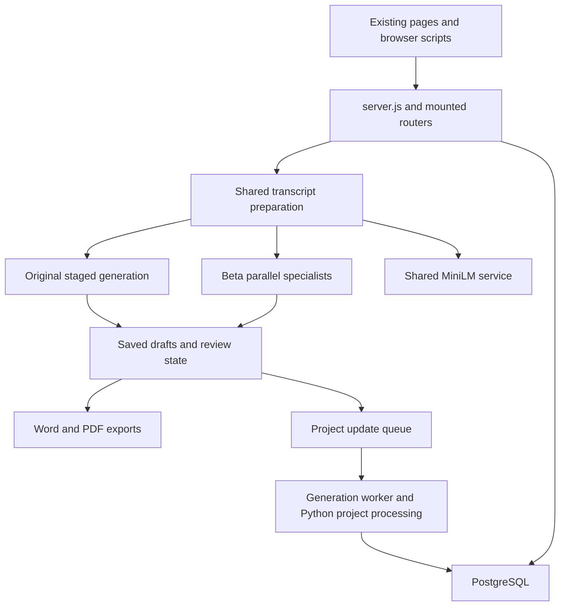

# Live product map and first cleanup boundaries

Inspected 30 October 2026 at deployed revision
`ea18d4ae5e0bb3dedb9ae9596f35fb89b60a1657` (PR #202).
This is the Stage 1 map: no application code, data or UI is changed.

## What runs

The product has one Express web process, two PM2 workers, and a shared MiniLM
system service. The main minutes editor runs both Original and Beta. Project
updates can start from the reviewed minutes produced by either engine.

The diagram shows the main handoff; the sections below include the additional
mounted pages, older processing paths and operational entry points.

| Entry point | Implementation | Observed status / responsibility |
| --- | --- | --- |
| Web | [`server.js`](../server.js), PM2 `trinzo`, cwd `/srv/m365-agent-test` | Online; serves pages, API, in-process minutes generation and polling. Default port 3978. |
| Generation queue | [`scripts/meeting_minutes_final_worker.js`](../scripts/meeting_minutes_final_worker.js), PM2 `trinzo-minutes-final-worker` | Online; claims meeting-minutes and project-update jobs from PostgreSQL. |
| Local rewriter | [`scripts/minutes_local_rewriter_worker.py`](../scripts/minutes_local_rewriter_worker.py), launched through bash by PM2 `trinzo-minutes-rewriter` | Online; imports `LocalMinutesRewriter` from `meeting_minutes_minilm_experiment.py`. No repo caller is needed for this external entry point. |
| Shared embeddings | `global-minilm.service`, deployed under `/srv/global-minilm` | Active; repo compatibility source is [`ops/global-minilm/global_minilm_worker.py`](../ops/global-minilm/global_minilm_worker.py). Used through loopback port 8767. Separate service deployment. |
| Knowledge embedding | [`utils/knowledge.js`](../utils/knowledge.js) → Python embedding/retrieval scripts | Spawned on demand; optional web-process interval. No separate Trinzo PM2 knowledge process was observed. |

The web configuration selects `legacy` by default, with hybrid V4 and speculative
processing enabled. Beta remains a per-upload choice for administrators and is
persisted as `generationProvider: parallel-specialists-v1`. Environment settings
can differ between processes: the web's Beta short-answer retention switch was
enabled while the two PM2 workers' switch was disabled. Do not infer one process's
configuration from another's. No provider calls were made during this audit.

## Pages and their owners

All local `/static/*` assets come from `public/`, except the timing helper served
directly from `utils/meetingMinutesTiming.js`. `server.js` owns page mounting and
redirects. “Mounted” proves availability in code; it does not prove recent use.

| Surface | Routes | Browser/source and backend owners |
| --- | --- | --- |
| Main minutes editor | `/` redirects to `/meeting-minutes-agent` | `views/meeting-minutes-agent.html`; `public/meeting-minutes-agent.js`, filing-order/project-link helpers; `/api/meeting-minutes-agent/*` in `routes/api.js`. |
| Library and saved jobs | `/jobs`, `/jobs/:jobId`, `/jobs/:jobId/result`; `/meeting-minutes-final/jobs*` aliases | `views/meeting-minutes-jobs.html` (inline browser code); draft/job endpoints in `routes/api.js`. Includes current drafts and queued-job compatibility. |
| Project workspace | `/project-update-test` with Setup, Process, Reports, Insights, Memory, Settings and Tasks stages | `views/project-update-workspace.html`; `public/project-workspace.js`, `project-stage-*.js`, `project-update-shared.js`; project endpoints in `routes/api.js`, tasks in `routes/internalAiTasks.js`. |
| Project deep links | `/project-update-test/reports/:reportId`, `/milestones/:milestoneId`, `/context/snapshots/:snapshotId` under the project prefix; `/project-update-test/roadmap`, `/roadmap` | Report, milestone, context and roadmap views. Old list routes redirect into workspace stages; retain their URLs. |
| Settings and insights | `/settings`, `/insights` | Settings/insights views and public scripts; `routes/settings.js`, `utils/settingsDb.js`, `utils/settingsStore.js`; minutes insights endpoint in `routes/api.js`. |
| Older mounted minutes surfaces | `/meeting-minutes-final`, `/staged-meeting-minutes`, its `/client-output`, `/pre-testing`, `/analytics`, plus `/staged-meeting-minutes-analytics` | Existing views, inline scripts and `public/test-transcript-page.js`; staged/final endpoints in `routes/api.js`. Their names do not establish that they are unused. |
| Feedback | `/meeting-minutes-feedback*`, `/review-feedback` | Feedback views; final feedback endpoints in `routes/api.js`; `routes/reviewFeedback.js`. Review snippet is injected by the standard page renderer. |
| Microsoft integration | `/meeting-agent`, `/meeting-agent/auth-redirect` | `client/meeting-agent*.js` bundled into `public/meeting-agent*.js`; `routes/meetingAgent.js` handles Microsoft identity, Copilot, uploads, transcript subscriptions and notifications. Separate from the main minutes editor. |
| Login and entry pages | `/dashboard`, `/auth`, `/auth/login`, `/login`, `/auth/forgot-password` | Dashboard/auth views and `routes/auth.js`. `/auth/register` and `/register-success` redirect to login; API self-registration is disabled. |

The Microsoft integration has a file-backed transcript subscription/event store
(default `/var/lib/m365-agent-test/transcript-subscriptions.json`). PostgreSQL is
not its only persistence boundary. Its webhook and callback routes must survive
route reorganisation, even if they have little browser traffic.

## Processing and persistence boundaries

1. **Shared upload/preparation.** `POST /api/meeting-minutes-agent/prepare` reads the
   upload, applies configured phrase corrections and calls
   [`utils/stagedMiniLmTrooper.js`](../utils/stagedMiniLmTrooper.js) →
   `scripts/staged_simplified_minilm.py`. That Python script imports the usefulness
   classifier and can use the shared embedding worker. The JS default classifier
   is `artifacts/meeting-minutes-usefulness-v3/classifier.joblib`; environment can
   select a different path. Both engines use this preparation boundary.
2. **Original.** `startInitialMeetingAgentProcessing`,
   `runMeetingAgentBackgroundStage` and `generateHybridMeetingAgentStage` in
   [`routes/api.js`](../routes/api.js) coordinate generation, provider calls,
   caches, review and publication. The first background stage is discussion;
   actions and summary have their own stage handling and speculation.
   `utils/meetingMinutesAgentV2.js`, `utils/canonicalMinutes/*` and staged helpers
   remain live dependencies. The main editor's background work runs in the web
   process, independently of the browser connection.
3. **Beta.** [`utils/meetingMinutesParallel.js`](../utils/meetingMinutesParallel.js)
   owns provider selection, draft projection, review changes and runner state;
   [`utils/meetingMinutesParallelEngine.js`](../utils/meetingMinutesParallelEngine.js)
   runs summary, discussion and actions concurrently. Prompt files live in
   `config/meeting-minutes-parallel/`. An external configuration file supplies
   published endpoints and instruction hashes; repo files alone do not recreate
   the provider deployment. Beta background work also runs in the web process.
4. **Saved drafts and review.** `utils/db.js` reads/writes drafts; `routes/api.js`
   handles ownership, optimistic revisions, edits, proposals, undo/redo,
   generation status and project links. Crucially, `utils/db.js` imports
   `migrateDraftPayload` from the entire V2 module just to read saved payloads.
   Keep wire schema version 4 separate from stored payload version 5.
5. **Exports.** The two authenticated `.../drafts/:draftId/export.docx` and
   `export.pdf` routes build publication projections. Word uses
   `utils/meetingMinutesAgentDocx.js` and JSZip; PDF uses
   `utils/stagedMinutesPdf.js`, Playwright Chromium and installed Roboto assets.
   Both engines export through these boundaries. Word no longer directly imports
   V2 following the earlier shared-helper extraction.
6. **Project handoff.** `POST /api/project-update-test/from-minutes` checks the
   saved revision, builds reviewed minutes text and carries reviewed actions
   separately via `utils/minutesForProjectUpdate.js`, then queues a job. The PM2
   generation worker runs `utils/projectUpdateGenerator.js` →
   `scripts/project_update_minilm.py`, with `python_llm.py` fallback and knowledge
   retrieval. The project's Beta switch chooses the minutes engine; it does not
   replace project-report generation. Direct/older project processing endpoints
   remain mounted too.
7. **Older queue/staged paths.** The same worker runs
   `utils/meetingMinutesGenerator.js` → `scripts/meeting_minutes_trooper.py` for
   minutes jobs. The staged endpoints also call Python/canonical processing from
   the web process. Preserve existing job types, polling aliases and result
   payloads until their callers and historical saved jobs are accounted for.
8. **Cross-cutting storage.** `utils/db.js` owns much of PostgreSQL access;
   `sql/` contains migrations. Settings persist people/glossary in PostgreSQL and
   publish a temporary Python snapshot through `utils/settingsStore.js`.
   `utils/knowledge.js` spawns embedding/retrieval scripts; project history,
   milestone binding and scoped internal tasks have additional helpers. CLI
   imports and backfills are operational tools, even when no page imports them.

## Product, evaluation and operations

| Classification | Examples | Cleanup rule |
| --- | --- | --- |
| Runtime code/data | Mounted views, routes, helpers, Python processors, classifier binaries, settings defaults, prompt configuration | Preserve until equivalent behaviour and every entry point are demonstrated. |
| Evaluation consumed by a mounted screen | `scripts/meeting-minutes-core-golden/{cases,human_benchmarks,run_record.csv,runs/}`, `artifacts/pre_testing_latest.json` | `utils/meetingMinutesCoreGolden.js` reads manifests, run records and recorded output paths for `/api/staged-meeting-minutes/pre-testing`. Archive only after tracing individual consumers and retaining displayed results. |
| Standalone evaluation / research candidates | Sweeps, paired replays, feasibility scripts, comparison reports | A lack of imports means candidate status. They may call paid providers, write caches/reports, or be run manually. Inspect inputs, outputs and external invocation before archiving; do not execute them to discover their purpose. |
| Operations | `deploy.sh`, SQL migration/backfill scripts, `meeting_minutes_topic_arranger_backfill.js`, `warm_minilm_cache.js`, Python shell wrappers | Preserve or document a replacement. The topic-arranger backfill can update saved drafts; it is not disposable research. |
| Build outputs | `public/meeting-agent.js`, `public/meeting-agent-auth-redirect.js` | Generated from `client/` by `scripts/build_meeting_agent.js`; do not edit generated bundles independently or mistake the source/output pair for duplicate features. |
| Documentation used as input | `docs/CURRENT_PROJECT_STATUS.md` | Input to the explicit task-import workflow and its tests, with frozen proposal references. It is not merely an obsolete prose page, nor an automatically read runtime configuration file. |

## First cleanup PRs

1. **Remove two unserved templates.** `views/auth-register.html` and
   `views/register-success.html` have no page handler and no filename references
   elsewhere in the tracked baseline. Their former URLs redirect to login, and
   API registration explicitly returns 404. Remove only the templates; preserve
   those redirects and the disabled-registration response. Check references and
   the affected login/redirect behaviour. This is a small, high-confidence batch,
   not the main source of code reduction.
2. **Extract the stored-draft migration boundary first.** Move `PAYLOAD_VERSION`,
   `STEP_V2_TO_V3` and `migrateDraftPayload` into a small dependency-free draft
   storage module. Have `utils/db.js` import it directly and keep V2's existing
   exports as compatibility re-exports. Leave the provider response schema and
   timing-policy constants unchanged. Preserve old step remapping, supporting
   detail defaults, current-version identity and idempotence. Existing migration
   cases are in `tests/meeting-minutes-agent-v2.test.js`; persistence and affected
   database fixtures must also pass. This removes the storage → entire generator
   dependency without changing what is stored or rendered.
3. **Then extract proposal handling.** V2's `buildProposal`, `applyProposal` and
   their local diff/matching helpers form a bounded group near lines 7477–7701.
   Dependencies include text cleanup, stable IDs/token matching and
   `meetingMinutesActionIdentity.js`. Preserve proposal IDs, duplicate occurrence
   handling, partial acceptance and stale-edit protection. Keep compatibility
   exports while moving actual consumers to the new module; otherwise file
   movement alone will not narrow test coupling.
4. **Split API routes after establishing service boundaries.** Start with a
   bounded family such as project CRUD or final-feedback CRUD. Preserve mount
   paths, middleware order, authentication and response/error shapes. Move shared
   operations into services before moving dependent handlers; do not have a new
   router import the old API router. Its `stagedEvaluation` export is also used by
   scripts and tests and needs a compatibility path during extraction.

The research-only archive from PR #201 remains separately recoverable through
`research-archive.json`. No additional archive or deletion is performed here.

## Evidence and limits

- The baseline contains 1,341 tracked files. Source sizes: `routes/api.js` 21,456
  lines; `meetingMinutesAgentV2.js` 7,862; `utils/db.js` 3,912; main editor browser
  script 4,554; `meeting_minutes_minilm_experiment.py` 6,883.
- Literal local-import tracing found 161 test files directly importing the API
  router and 151 directly importing V2. Counts exclude dynamic-path imports and
  are a lower bound, not a complete execution graph.
- Inspected server/router mounts, browser references, child-process dispatch,
  Python imports, filtered PM2 configuration, root cron and local system-service
  definitions. Static no-reference candidates included the live rewriter: this
  demonstrated why static absence alone cannot certify deletion.
- Raw inventories are kept outside the product tree at
  `/root/trinzo-live-map-20261030/` on the VPS, including route locations and
  filtered process/entry-point snapshots. They contain no credential values.
- Recent per-route usage, off-VPS automation, manual CLI use and external
  provider behaviour were not measured. Mounted legacy screens and standalone
  tools remain in the uncertain-use category until that evidence exists.
- Stage 1 is documentation only. Validation consists of source/reference/link
  checks and a clean runtime diff; no AI calls, benchmark replays, database
  writes, service restarts or full regression run are needed for this map.
